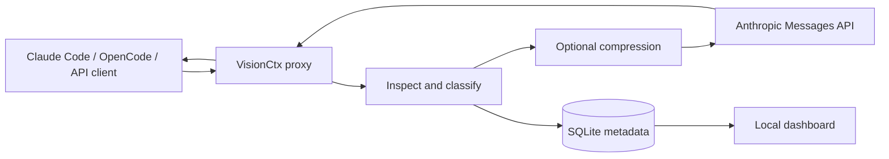

# VisionCtx

> Visual context compression and observability for AI coding agents.

VisionCtx is a local Anthropic Messages proxy for Claude Code, OpenCode, and direct API clients. Coding agents accumulate source files, terminal logs, tool results, MCP output, and conversation history. VisionCtx records a request timeline and shows how eligible context was classified and transformed.



The default mode is **passthrough**. Image conversion is experimental and disabled by default. No savings are claimed without a real baseline, provider usage, current prices, and task correctness checks.

See [a Messages request example](examples/messages.json) for the tool-use shape VisionCtx inspects.

## Quick start

Requires Node.js 22.13 or newer. For direct API-key routing, provide an Anthropic API key; an existing Claude Code subscription login worked in one live passthrough smoke test but is not guaranteed across accounts or versions. The repository is the package; after cloning it:

```bash
npm install
cp .env.example .env
# For API-key routing, put ANTHROPIC_API_KEY in .env or supply it from your shell.
npm run build
npm run start
```

In a second terminal:

```bash
ANTHROPIC_BASE_URL=http://127.0.0.1:8787 claude
```

Open `http://127.0.0.1:8788`, run a coding task, and inspect its request. `node dist/apps/cli/index.js doctor` checks the local proxy and reports whether a process API key or successful upstream traffic was observed without printing credentials. The package binary is named `visionctx`; in a source checkout, use `node dist/apps/cli/index.js <command>` or `npm run start`.

For OpenCode, use a project-local Anthropic provider `baseURL`; see [OpenCode setup](docs/opencode.md). Direct Anthropic SDK clients may set their base URL to `http://127.0.0.1:8787`.

## What is implemented

- Native Anthropic Messages proxy with POST passthrough, status/header forwarding, SSE streaming, upstream errors, and request IDs.
- Metadata/event capture in SQLite; body capture is off by default, with bounded in-memory inspection of safe text blocks.
- Anthropic text and tool-result inspection, JSON minification, repeated-log compression, opt-in extractive summaries, and experimental PNG conversion for eligible tool-result strings.
- Local dashboard with overview, request explorer, block inspector, sanitized final payload, events, and image previews.
- Tests for passthrough bytes, SSE usage, security, parsing, and PNG output.

## Current limits

- Claude Code 2.1.281 completed a one-turn live passthrough smoke test through VisionCtx using an existing subscription login on 2026-10-07. This verifies the local route for that version and account, not universal subscription compatibility. API-key routing is separately supported.
- A live read-only tool-call attempt reached VisionCtx with tool-use and tool-result blocks, but hit a two-turn limit and included upstream HTTP 400 responses. End-to-end tool-call success remains unverified for this subscription path.
- OpenCode has a documented native Anthropic base-URL path, but a live OpenCode run has not been completed here. Local integration tests also use a mock upstream.
- Image readability and task accuracy have not been benchmarked, so image mode is off by default.
- Semantic summarization, learned compression, verified cost savings, and PostgreSQL are not implemented. An optional original-request token-count probe is available for transformed API-key requests. A small A/B harness exists but has not been run against Anthropic here.
- The local renderer depends on the installed platform canvas package and available monospace font. Cross-platform output should be checked before using golden image hashes.

See [research](docs/research.md), [architecture](docs/architecture.md), [installation](docs/installation.md), and [security](docs/security.md).

## Development

```bash
npm test
npx tsc --noEmit
```

The project is MIT licensed. Contributions are welcome; see [CONTRIBUTING.md](CONTRIBUTING.md).
