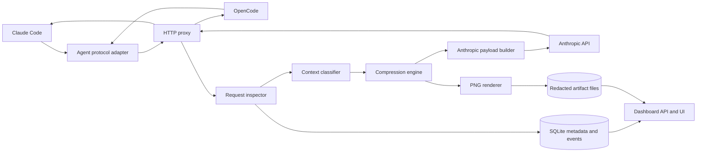
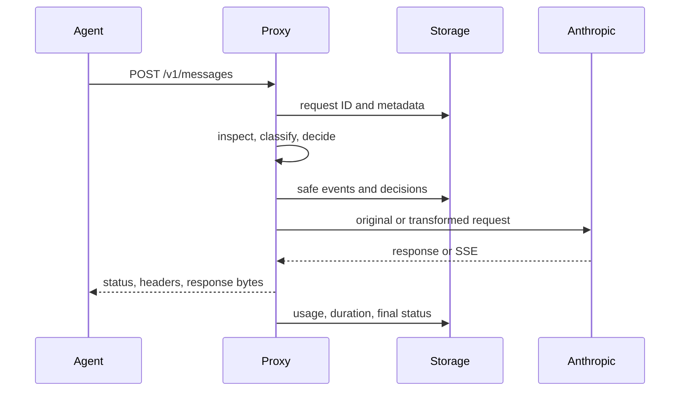

# VisionCtx architecture

## Boundaries

The HTTP/protocol adapter owns headers, paths, status, streaming and authentication forwarding. The Anthropic codec owns Messages parsing and reconstruction. The classifier emits logical blocks and immutable JSON locations. The compression engine makes a per-block decision and records alternatives, expected tokens, risk and reason. Strategies implement `canHandle`, `estimate`, `compress`, `restore` and `metadata`. The renderer returns PNG pages plus dimensions and timing. Token/cost analysis distinguishes provider usage from estimates. Storage owns migrations, metadata and redacted artifacts. The dashboard consumes a versioned inspection API and does not call strategy internals.

## Request sequence

In passthrough mode, the wire body is the original byte buffer and all transformation stages are observational. Parsing failure cannot change forwarded bytes. Request/response bodies are not persisted by default. The event writer is best effort and cannot interrupt streaming.

## Data model

`requests` stores ID, time, provider, model, endpoint, status, duration and sizes. `events` stores stage, time, duration, state and sanitized metadata. `context_blocks` stores type, byte count, token estimate, risk, strategy and redacted artifact reference. `compressions` stores selected strategy, rationale, original/final estimates and fallback. `images` stores path, dimensions, format, bytes, render time and estimated tokens. `token_usage` stores exact provider fields with an `ACTUAL` source label and counterfactual counts with an `ESTIMATED` label. `cost_records` stores pricing version, basis and calculated totals. `evaluations` stores task outcomes. Migrations version the schema; artifacts live under `data/requests/<request_id>/` only after redaction and explicit capture configuration.

## Invariants

1. Passthrough forwards the request body and SSE chunks unchanged.
2. Unknown Anthropic block types remain unchanged; tool IDs and ordering remain intact.
3. No secret-bearing value reaches SQLite, an artifact, a dashboard response or a diagnostic archive.
4. A failed transform restores the original request before upstream dispatch, with a recorded reason.
5. Actual usage comes only from Anthropic's response; baseline counts and image-token arithmetic remain estimates.
6. A cacheable prefix is never transformed by the default policy.

## Provider extension

Provider adapters expose route matching, request inspection, block extraction, payload rebuild, usage extraction and capability checks. The engine sees provider-neutral blocks and does not know Claude Code or OpenCode. Only the Anthropic Messages adapter is in the initial implementation. Future OpenAI/Google adapters must prove their own streaming and tool-call invariants.

## Implementation phases

Phase 1: transparent proxy plus SSE/error tests. Phase 2: metadata/events and redaction. Phase 3: Anthropic context blocks and inspector. Phase 4: deterministic strategies and renderer behind explicit experimental mode. Phase 5: dashboard, benchmark harness, A/B evaluation and integration guides. Each phase must pass its invariants before becoming the default.
